# ThaaLam

**A sample-accurate metronome and tala practice companion for iOS and Android.**

ThaaLam is built with the same technology stack as the sibling Ukulele
Companion project: Kotlin Multiplatform for the shared domain, Jetpack Compose
on Android and SwiftUI on iOS. The metronome engine was
rebuilt around a frame-counting audio clock, then extended with additive meters,
four-level accents, swing, practice automation, layered polyrhythms and a
first-class Carnatic / Hindustani tala practice engine with kalam, kalai,
eduppu and anga gestures.

<p align="center">
  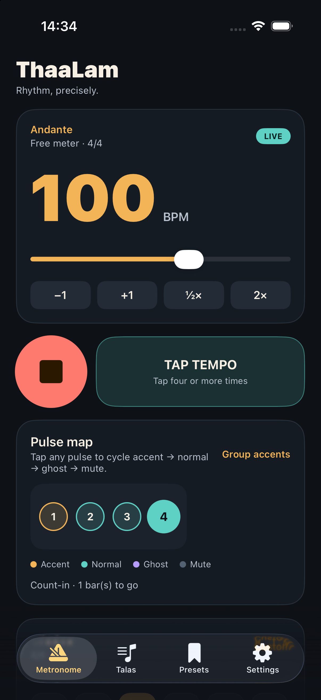
  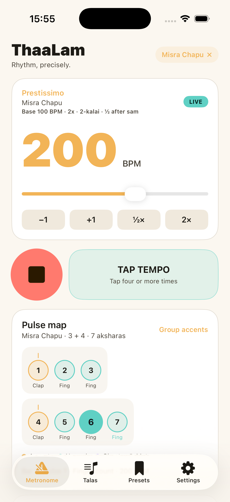
  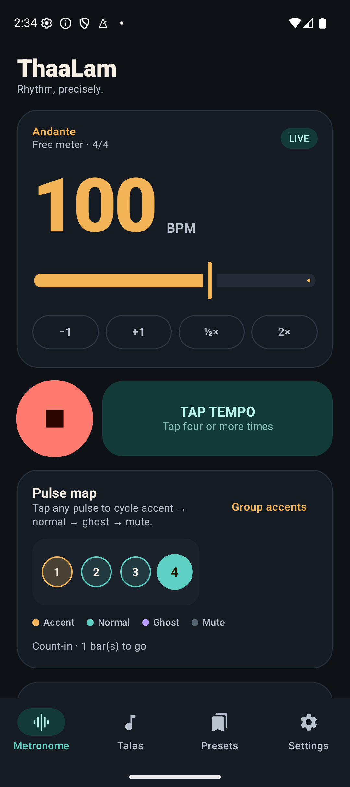
  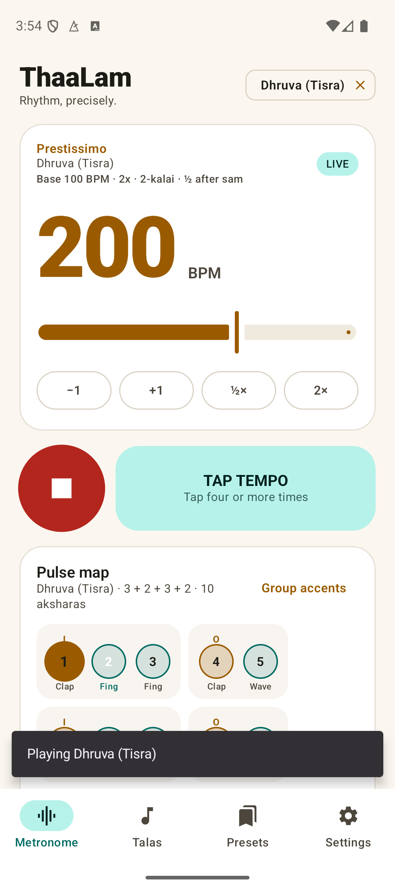
</p>

<p align="center">
  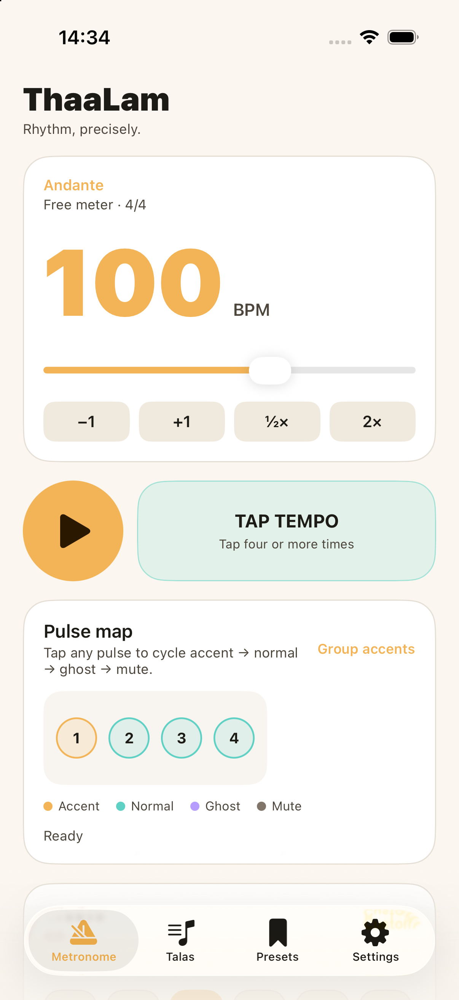
  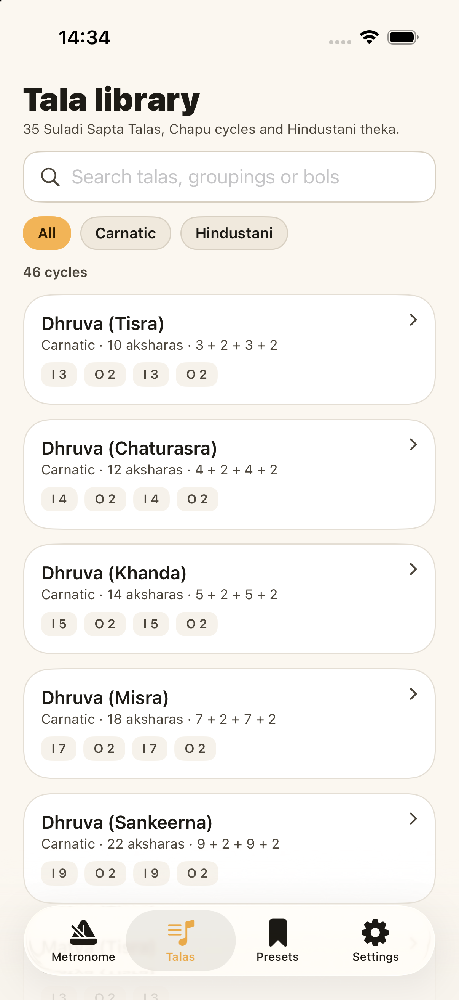
  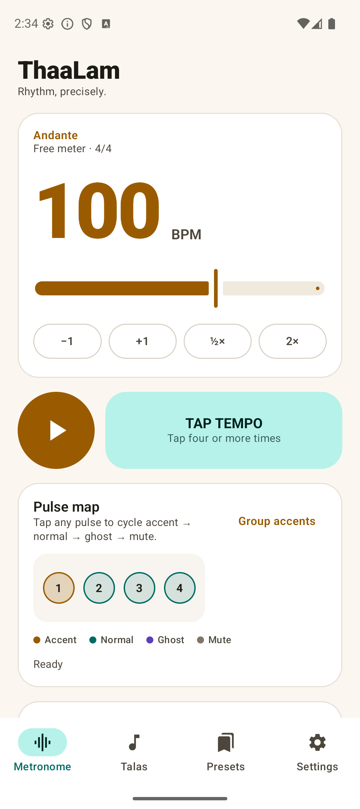
  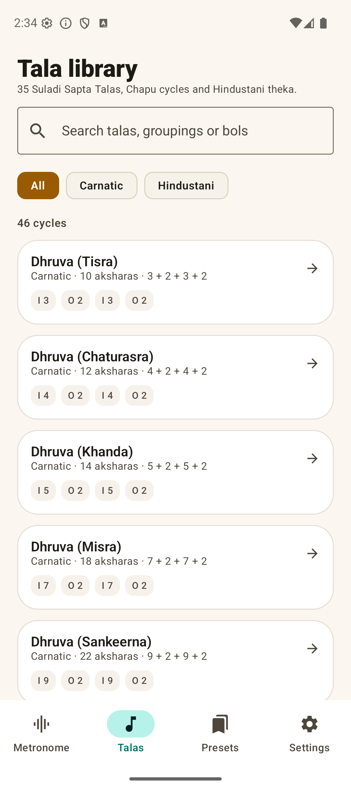
</p>

---

## What is implemented

### Time and groove

- **10 – 400 base BPM** with fractional values, logarithmic tempo slider, ±1 and
  half/double buttons, plus a numeric tempo dialog. Kalam can take the effective
  akshara rate up to 4× the base tempo without losing the base value.
- **Tap tempo** with an eight-tap rolling average, silence resets and a
  stability readout.
- **Meters with additive grouping**: 2/4, 3/4, 4/4, 5/4, 6/4, 7/4, 5/8, 6/8,
  7/8, 8/8, 9/8, 11/8, 12/8, plus a custom meter dialog (1–32 pulses, beat unit
  2/4/8/16, arbitrary grouping such as `2+2+3`).
- **Subdivisions from quarter to nonuplet**: 1/4, 1/8, triplets, 1/16,
  quintuplets, sextuplets, septuplets, 1/32 and nonuplets.
- **Swing** from 50% straight through 66.7% triplet shuffle to 75% dotted, with
  the change applied on release so dragging never interrupts the bar.
- **Four accent states per pulse**: accent, normal, ghost and mute, cycled by
  tapping the pulse in the beat map. Any pattern is allowed — including a fully
  muted bar.
- **Gesture-aware pulse map**: each akshara shows its tala gesture (clap,
  finger, wave, tali or khali) under the beat number.
- **Group accents** restores the accents implied by the additive grouping.

### Layers

- **Up to three additional voices** over the primary pulse, mixed at exact
  sample positions on the same clock.
- **Subdivision mixer**: add an eighth, sixteenth, triplet, quintuplet,
  septuplet, 1/32 or nonuplet layer without changing the main subdivision.
- **Polyrhythm**: 3 over 2, 4 over 3, 5 over 4, 7 over 5, 7 over 6, or a custom
  pulses-per-cycle value.
- **Polymeter**: give a layer its own cycle length (for example 3/4, 5/4, 5/8 or
  7/8) against the main bar; the cycles realign at their least common multiple.
- **Per-layer control**: enable, solo, gain, sound set, ±50 ms offset, swing,
  and a four-state accent pattern for every pulse.
- **Per-pulse micro-timing**: nudge an individual pulse through −20, −10, 0,
  +10 and +20 ms.
- **Composite cycle view**: concentric rings show the primary pulse and each
  active layer, with a text summary for screen readers.
- Layers follow count-in, gap training, stochastic muting and tempo changes;
  editing an accent never restarts the primary bar.

<p align="center">
  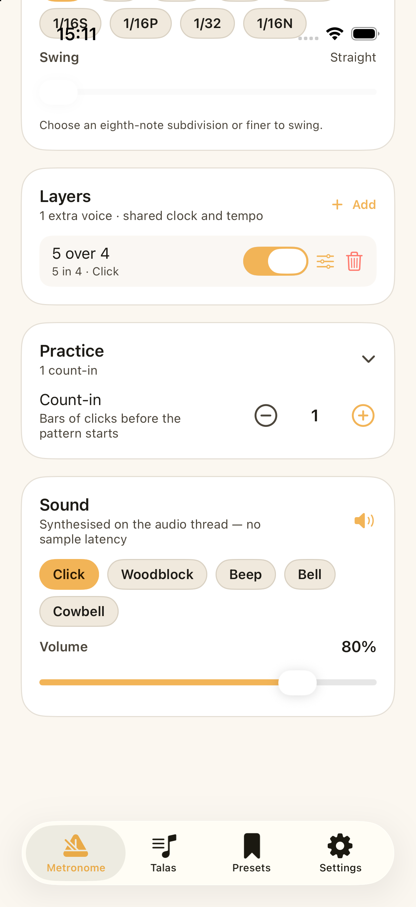
  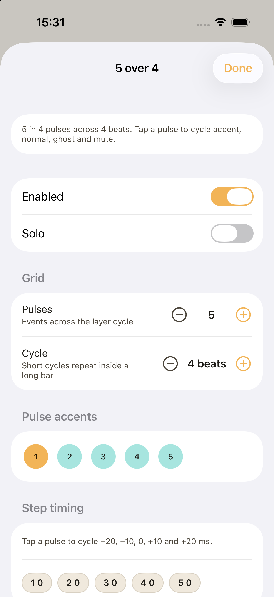
  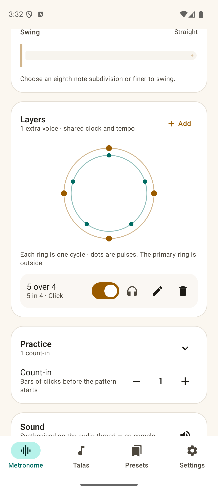
  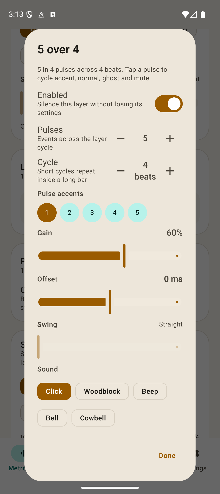
</p>

### Sound and feel

- **Procedural click synthesis** on the audio thread: five timbres (Click,
  Woodblock, Beep, Bell, Cowbell), accent-dependent pitch, ghost/subdivision
  velocity and exponential decay. No bundled click samples and no codec latency.
- **Anga gesture timbres**: clap, finger count, wave, tali and khali colour the
  click so a laghu or a Hindustani vibhag is audible as a gesture, not a flat
  run of identical pulses.
- **Sample-accurate scheduling**: both platforms count rendered audio frames
  instead of relying on timers. Android writes 256-frame buffers to a
  low-latency `AudioTrack`; iOS schedules inside an `AVAudioSourceNode` render
  callback.
- **Background playback**: Android uses a foreground media-playback service
  with a transport notification; iOS declares the audio background mode and a
  `.playback` audio session.
- **Haptic pulse** (main pulses only) and **screen flash**.
- **Visual latency calibration** (0–300 ms) for Bluetooth headphones: the visual
  pulse is delayed so it lands with the click the listener actually hears.
- **Master volume**, **count-in** (0–4 bars), and a live effective-BPM readout
  while a tempo ramp is running.

### Practice tools

- **Gap trainer**: play *N* bars, stay silent for *M* bars while the clock keeps
  running.
- **Stochastic muting**: 0–100% random drop-outs with optional protection of the
  sam (first pulse of the bar).
- **Stepped tempo ramp**: target BPM, step size and bars-between-steps.
- All practice decisions run inside the audio engine's scheduling loop, so gap
  bars and random mutes never disturb the phase clock.

### Tala engine

The name *ThaaLam* comes from the Tamil word for a rhythmic cycle. Talas are not
a separate playback mode: a tala is compiled into the same meter, grouping and
accent pattern used by the Western metronome, so every audio feature (subdivision,
swing, gap, ramp, haptics) works with it.

- **All 35 Carnatic Suladi Sapta Talas** — Dhruva, Matya, Rupaka, Jhampa,
  Triputa, Ata and Eka across Tisra, Chaturasra, Khanda, Misra and Sankeerna
  jathis.
- **Chapu talas**: Misra Chapu, Khanda Chapu and Tisra Chapu.
- **Hindustani cycles**: Teental, Jhaptal, Rupak, Ektaal, Dadra, Keherwa,
  Deepchandi, Jhoomra and Tilwada, with vibhag markers (`X`, `2`, `3`, `0`) and
  theka bols for every cycle where a stable, commonly taught version is known.
- **Sam, tali and khali** map to accent, accent and ghost. Sam is always the
  first pulse; Rupak correctly starts on khali.
- **Nadai / gathi** subdivision for Carnatic cycles: Tisra 3, Chatusra 4, Khanda
  5, Misra 7, Sankeerna 9, or none.
- **Kalam 1× / 2× / 4×** scales the akshara rate while keeping the base tempo;
  changing it while playing never restarts the cycle.
- **Kalai 1 / 2** adds a second click inside every akshara and multiplies the
  chosen nadai.
- **Eduppu** starts the cycle at sam, a fraction before sam (atita) or after sam
  (anagata); the count-in is phase-aligned so its final click lands immediately
  before the requested start point.
- **Anga gestures** drive both the click timbre and the on-screen symbols:
  clap, finger count, wave, tali and khali.
- **Theka display with live bol highlighting**, plus gesture labels on the pulse
  map and tala cycle.
- Tala browser with search (names, groupings and bols), tradition filter, anga
  pills, cycle diagram, theka syllables, load and start-in-place.
- **Practice presets**: any kalam/kalai/eduppu combination can be saved as an
  ordinary preset from the tala sheet.
- Tempo is preserved across tala selection, and the active tala is shown on the
  metronome screen with a one-tap exit.
- **108 Ashtottara talas** are not included yet: the published lists found so
  far disagree, and the roadmap requires a verified source plus a Carnatic
  practitioner review before shipping them. The catalogue is data-only, so the
  set can be added without engine changes once that review exists.

<p align="center">
  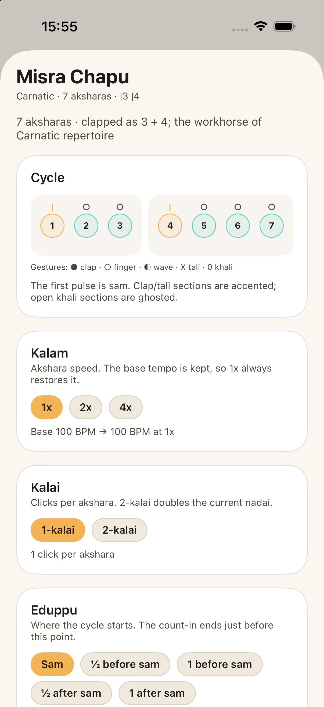
  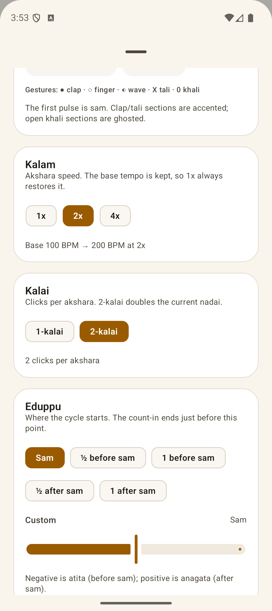
</p>

### Presets and persistence

- Save the full current setup (tempo, meter, grouping, subdivision, accents,
  swing, sound, count-in, practice options and tala) as a named preset.
- Three starter presets on first launch: Daily warm-up, Teental · 120 and
  Odd meter · 7/8.
- Presets and settings are stored **on device only**. Both platforms read and
  write the same JSON schema, so the format is portable even though the app has
  no network or account layer.

### Accessibility

- Every beat carries a number, a dynamic name and a section marker; colour is
  never the only signal.
- TalkBack/VoiceOver labels and hints on the beat map, play control, tap pad,
  sliders, switches, tala cards and preset actions.
- Reduced-motion handling on both platforms (Android animator scale, iOS
  `accessibilityReduceMotion`).
- Large BPM numerals, dynamic-section cards and light/dark palettes with
  contrast-checked text.

---

## Technology stack

| Layer | Technology |
|---|---|
| Shared domain | Kotlin 2.4.20 Multiplatform (`:shared`), kotlinx.serialization |
| Android UI | Kotlin, Jetpack Compose (BOM 2026.09.00), Material 3, MVVM + StateFlow |
| Android audio | `AudioTrack` low-latency stream, real-time procedural synthesis |
| Android background | Foreground service with media-playback notification |
| iOS UI | Swift 5/6 (Swift 5 language mode), SwiftUI, `ObservableObject` |
| iOS audio | `AVAudioEngine` + `AVAudioSourceNode` render callback |
| iOS background | Audio background mode + `AVAudioSession` `.playback` |
| Build | Gradle 9.7.1, AGP 9.4.1, Kotlin Multiplatform, XcodeGen, Xcode 26/27 |
| Minimums | Android 8.0 (API 26), iOS 16.0 |

---

## Repository layout

```
ThaaLam/
├── app/                              Android application
│   ├── src/main/java/com/baijum/thaalam/
│   │   ├── audio/
│   │   │   ├── ClickSynth.kt         polyphonic procedural click voices
│   │   │   ├── MetronomeAudioEngine.kt  AudioTrack frame clock + sequencer
│   │   │   ├── MetronomeController.kt   app-scoped state, focus, haptics
│   │   │   └── MetronomeService.kt      foreground playback notification
│   │   ├── data/                     SharedPreferences settings + presets
│   │   ├── ui/
│   │   │   ├── components/           beat grid, cards, steppers, chips
│   │   │   ├── screens/              metronome, talas, presets, settings
│   │   │   └── theme/                colour, type and slider/chip theming
│   │   └── viewmodel/MainViewModel.kt
│   └── src/test/                     (Android host tests can be added here)
├── shared/                           Kotlin Multiplatform domain
│   └── src/commonMain/kotlin/com/baijum/thaalam/
│       ├── data/                     Meter, Subdivision, BeatKind, LayerSettings,
│       │                             Tala, MetronomeSettings, MetronomePreset
│       └── domain/
│           ├── RhythmPattern.kt      one-bar primary click grid
│           ├── VoicePattern.kt       compiled voice grid for the engines
│           ├── LayerCompiler.kt      subdivision / polyrhythm / polymeter compiler
│           ├── TimingSimulator.kt    deterministic frame-level scheduling tests
│           ├── TempoMath.kt          frame math, markings, ramping
│           ├── PracticeLogic.kt      gap / mute / ramp decisions + LCG
│           ├── TalaLibrary.kt        35 Suladi + Chapu + Hindustani catalogue
│           ├── TalaApplication.kt    tala → metronome settings compiler
│           ├── TapTempo.kt           rolling tap detector
│           ├── PresetCodec.kt        shared JSON persistence
│           ├── MetronomeStateLogic.kt
│           └── SwiftInterop.kt       Swift-friendly mutation/factory API
├── iosApp/                           XcodeGen project + SwiftUI app
│   ├── project.yml                   generated project definition
│   ├── ThaaLam.xcodeproj             committed generated project
│   └── ThaaLam/
│       ├── Audio/                    AVAudioSourceNode engine, ClickSynth
│       ├── ViewModels/               MetronomeViewModel
│       ├── Views/                    metronome, talas, presets, settings
│       ├── Storage/                  UserDefaults + shared JSON codec
│       └── Theme.swift
├── docs/
│   ├── screenshots/
│   ├── architecture.md               engine and data-flow deep dive
│   └── roadmap.md                    release plan
├── CHANGELOG.md
└── references/                       market and product research reports
```

---

## Build and run

### Prerequisites

- JDK 17 or newer (JDK 21 is used locally).
- Android SDK platform 37, build-tools 36.x, and an emulator or device (API 26+).
- Xcode 16+ with an iOS 16+ simulator or device.
- [XcodeGen](https://github.com/yonaskolb/XcodeGen) for regenerating the iOS
  project (`brew install xcodegen`).

Set the Android SDK path in `local.properties`:

```properties
sdk.dir=/Users/you/Library/Android/sdk
```

### Android

```bash
./gradlew :shared:jvmTest          # shared domain tests
./gradlew :app:assembleDebug       # debug APK
./gradlew :app:lintDebug           # Android lint
./gradlew :app:assembleRelease     # R8 release APK (unsigned without a keystore)
adb install -r app/build/outputs/apk/debug/app-debug.apk
```

The release build expects a signing configuration if you have one. Add
`keystore.properties` and a `signingConfig` in `app/build.gradle.kts` for Play
Store uploads.

### iOS

```bash
cd iosApp
xcodegen generate
open ThaaLam.xcodeproj
```

Or from the command line:

```bash
cd iosApp
xcodebuild -project ThaaLam.xcodeproj -scheme ThaaLam \
  -destination 'platform=iOS Simulator,name=iPhone 17 Pro' \
  -configuration Debug CODE_SIGNING_ALLOWED=NO build
```

The Xcode target has a pre-build phase that runs
`./gradlew :shared:assembleShared${CONFIGURATION}XCFramework`, so the Kotlin
framework is always in sync with the app. The generated
`shared/build/XCFrameworks/{debug,release}` slices are linked statically.

For a device build, select your team in Signing & Capabilities and let Xcode
build the `iosArm64` slice.

---

## Architecture in one page

```
┌────────────────────────────── Shared Kotlin ──────────────────────────────┐
│ MetronomeSettings  Meter  Subdivision  BeatKind  LayerSettings  Tala       │
│        │                                                                  │
│        ├── RhythmPattern.build(settings) → primary steps + gaps           │
│        ├── LayerCompiler → subdivision / polyrhythm / polymeter voices    │
│        ├── TalaLibrary / TalaApplication → meter + grouping + accents     │
│        ├── PracticeLogic → gap / stochastic mute / ramp decisions         │
│        ├── TimingSimulator → deterministic frame-level test contract      │
│        ├── TempoMath → BPM ↔ seconds ↔ sample frames                      │
│        ├── TapTempo, PresetCodec, MetronomeStateLogic                     │
│        └── SwiftInterop: SettingsMutations / PatternFactory / factories   │
└───────────────┬───────────────────────────────────────────┬───────────────┘
                │ Kotlin/JVM                                │ Kotlin/Native
┌───────────────▼────────────────┐              ┌───────────▼───────────────┐
│ Android: MetronomeAudioEngine  │              │ iOS: MetronomeAudioEngine │
│ AudioTrack 48 kHz, 256 frames  │              │ AVAudioSourceNode render  │
│ frame position + voice cursors │              │ frame position + cursors  │
│ ClickSynth voices              │              │ ClickSynth voices         │
│ controller → StateFlow → UI    │              │ controller → @Published   │
└────────────────────────────────┘              └───────────────────────────┘
```

### Why the timing is stable

Both engines maintain an absolute frame position and a `Double` frame position
for each voice's next click. A click's interval is derived from the shared
compiled grid:

```text
framesPerBeat = 60 / BPM * sampleRate
nextTickFrame += gapBeats * framesPerBeat
```

Because the position is a `Double`, fractional BPM values, swing, tuplets,
polyrhythm and polymeter never accumulate integer rounding drift. Voices are
ordered by their next frame, so a layer tick before a bar boundary still belongs
to the old bar. Clicks are mixed at their exact sample offset inside the buffer,
and a click voice can carry its tail across buffer boundaries. Nothing schedules
audio from a UI timer.

- **Android** writes on a dedicated `THREAD_PRIORITY_URGENT_AUDIO` thread to an
  `AudioTrack` created with `PERFORMANCE_MODE_LOW_LATENCY`, 48 kHz mono float.
- **iOS** performs the same scheduling inside the `AVAudioSourceNode` render
  block; settings are converted to plain Swift values on the main thread so the
  real-time path never calls into the Kotlin runtime.

The Kotlin pattern builder is unit-tested independently of either audio device.
See [docs/architecture.md](docs/architecture.md) for the detailed scheduling
walkthrough, practice gating and data format.

### Why talas share the metronome engine

A tala compiles to:

- `meter = Meter(aksharas, 4, grouping = angaLengths)`
- `accentPattern = sam/tali = ACCENT, khali = GHOST, elsewhere NORMAL`
- `subdivision = nadai`

That means a tala inherits count-in, gap training, stochastic muting, ramp,
haptics, swing, latency calibration and presets without a parallel code path.
The tala library is pure data and is tested for all 35 Suladi combinations,
canonical lengths, khali placement and theka lengths.

---

## Testing

```bash
./gradlew :shared:jvmTest      # 127 shared tests: meters, layers, patterns,
                               # talas, kalam/kalai/eduppu, gestures,
                               # practice logic, tap tempo, presets
./gradlew :app:lintDebug       # Android lint
./gradlew :app:assembleDebug
```

Manual verification performed during development:

- Android emulator (API 36): clean launch, metronome start/stop, count-in,
  tala selection and playback at 2× kalam / 2-kalai / ½-after-sam eduppu,
  gesture timbres and labels, adding/toggling a 5-over-4 layer while playing,
  composite rings, solo and per-pulse timing, foreground service while
  backgrounded, dark mode.
- iOS simulator (iPhone 17 Pro): clean launch, metronome playback, tala detail,
  tala playback at 2× kalam / 2-kalai / ½-after-sam eduppu, gesture timbres and
  labels, layer picker/editor, composite rings, solo and per-pulse timing,
  5-over-4 layer while playing, light/dark mode, audio session start without
  errors.

iOS audio is verified by scheduling and rendering; a hardware loopback test is
recommended before shipping for measuring output latency on real devices.

---

## Status against the research reports

| Area | Status |
|---|---|
| Core click, time signatures, subdivisions, accents, tap tempo | ✅ implemented |
| Sample-accurate audio, low-latency engines, background playback | ✅ implemented |
| Count-in, gap trainer, stochastic muting, tempo ramp | ✅ implemented |
| Swing, ghost notes, tuplets up to nonuplets, additive meters | ✅ implemented |
| Carnatic Suladi Sapta Talas, Chapu, nadai, Hindustani theka | ✅ implemented |
| Presets, haptics, flash, visual latency calibration | ✅ implemented |
| Subdivision mixer, polyrhythm / polymeter layers, solo, per-pulse timing | ✅ implemented (v0.2) |
| Kalam, kalai, eduppu, anga timbres, theka highlighting, practice presets | ✅ implemented (v0.3) |
| 108 Ashtottara talas | ◻ deferred pending a verified published list and practitioner review |
| Chained mixed-meter songs, setlists, stage mode, continuous ramps | ◻ planned for v0.4 |
| Practice log, streaks, tap-accuracy grader, LiveBPM tempo induction | ◻ planned for v0.5 |
| Drone / temperament / pitch engine, custom samples, recording, localization | ◻ planned for v0.6 |
| MIDI clock / BLE-MIDI, Ableton Link, network ensemble sync | ◻ deferred (offline constraint) |

The two documents in [`references/`](references/) were used as the product and
technical brief. Features that require networking, a backend, third-party SDKs
or audio input were deliberately kept out of this first release; the current app
is fully offline and has no analytics, ads, accounts or network permissions.

A detailed, release-by-release plan is in [`docs/roadmap.md`](docs/roadmap.md);
release notes are in [`CHANGELOG.md`](CHANGELOG.md).

---

## Design principles

1. **The clock is the audio device.** No timer, no drift.
2. **The shared module owns musical meaning.** Meters, accents, talas, practice
   gating and preset schemas are Kotlin code with tests, not duplicated UI logic.
3. **The stage comes first.** Large numerals, one-tap transport, high-contrast
   beat states and a play control that stays above the fold even for 22-akshara
   talas.
4. **Offline by design.** Everything is local; no permission is requested for
   anything except vibration and the optional playback notification.
5. **Accessible by default.** Every graphical pulse has text semantics, and
   motion respects the platform reduce-motion setting.

---

## Credits

- Metronome foundation adapted from the Ukulele Companion project
  (`MetronomeStateLogic`, `MetronomeEngine`, `ClickSoundPlayer`), rewritten for
  sample-accurate scheduling and expanded into a standalone app.
- Tala naming and structure follow the Carnatic Suladi Sapta Tala system and
  common Hindustani theka practice; the research reports in `references/`
  informed the feature set.
- Built with Kotlin Multiplatform, Jetpack Compose and SwiftUI.

---

## License

No license file has been added yet. Choose a license (for example MIT, matching
the reference project) before distributing the app or the source.
