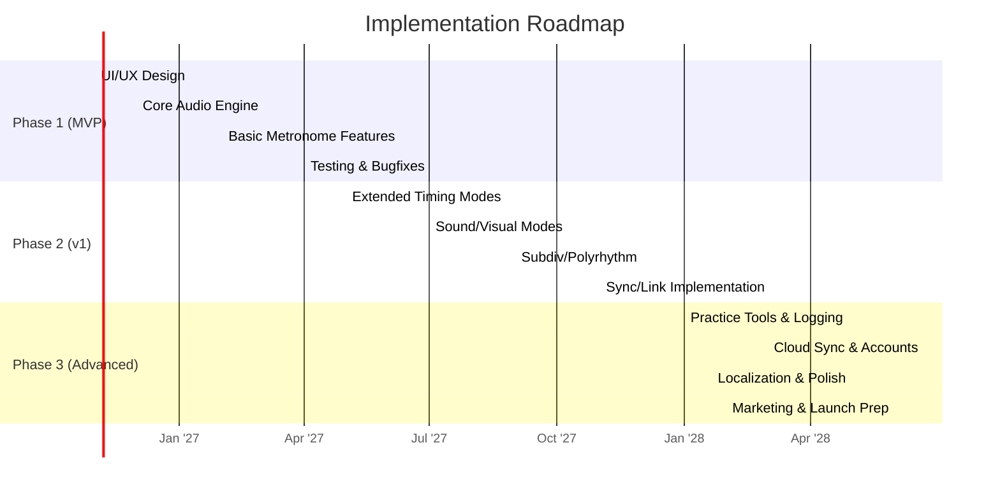

# Executive Summary  
This report surveys the market and technology for a **sophisticated metronome app** (iOS, Android, optional web) aimed at musicians, students, teachers, and producers. We assume no strict budget/timeline constraints. First, we analyze the top 15 metronome apps, summarizing their platforms, pricing, ratings, and standout features. We then compile a comprehensive feature set, categorizing required and optional capabilities in timing/tempo (subdivisions, polyrhythms, tempo maps, swing, etc.), sound (multiple click types, accents, custom samples, latency compensation), visual cues (screen flash, moving pendulum, score sync), I/O (MIDI in/out, Ableton Link, BLE-MIDI, OSC, audio clock), synchronization (network sync, NTP/PTP), practice tools (loops, count-in, modulations, exercises, progress tracking), UI/UX (accessibility, themes, gestures), analytics, sharing, cloud/offline support, localization, and monetization.  

We outline the **technical requirements**: a low-latency audio engine with sample-accurate timing, platform APIs (CoreAudio/AVAudioEngine on iOS, AAudio/Oboe on Android), background audio, performance profiling, storage, security/privacy practices, and third-party integrations. We review research on **human tempo perception**, noting that the just-noticeable difference in tempo is about 2–5% (≈5–20 ms at typical tempos), and that jitter (timing instability) is more detrimental to the feel of steady rhythm than raw latency. Thus we target sub-10 ms jitter in practice.  

We provide a **prioritized feature list** with effort estimates (Low/Medium/High), a comparison table of leading apps, and suggested technical architecture. An implementation **roadmap** is proposed in three phases (MVP, v1, advanced), with timeline diagram. We also discuss **accessibility/localization best practices** and **monetization strategies** (free core vs premium features, subscription vs one-time, go-to-market tips). Finally, we highlight **risks and legal/privacy issues** (e.g. data consent, IP for algorithms or content), and recommend libraries/SDKs (e.g. CoreAudio, Oboe, Ableton Link SDK) and authoritative sources.

All findings are cited from primary/official sources and research papers. 

## 1. Competitive Analysis  

### 1.1 Top Metronome Apps (Overview)  
We identified ~15 leading metronome apps across iOS/Android. Table 1 compares their **platforms, pricing, ratings, and unique features**. Key players include Soundbrenner, Tempo, Pro Metronome, PolyNome, TonalEnergy, Metronome Beats, Takt, Time Guru, Tack, Soundcorset, and several simpler/free options (Simple Metronome, Pulse, Metronomerous, etc.). Each row lists the app’s key capabilities and citations to sources describing them.  


| **App**                          | **Platform**       | **Price Model**                     | **Rating (≏2026)**                  | **Key Features / USP**                                 |
|----------------------------------|--------------------|-------------------------------------|-------------------------------------|--------------------------------------------------------|
| **Soundbrenner Metronome**  | iOS, Android       | Free with IAP/subscription (Soundbrenner Plus: ₹799/mo or ₹5999/yr) | ⭐ 4.6★ (90K+ reviews, Google Play)   | Custom time signatures, subdivisions, accents; tap tempo; 20+ sounds; count‑in; setlists; **USB & Bluetooth MIDI**, **Ableton Link** sync; practice tracker (goals, streaks, per-instrument time); light/dark themes. Plus features: incremental tempo changes, muted‑beat trainer, cloud sync. Integration with Soundbrenner wearable (haptic) for silent cues. |
| **Tempo (by Frozen Ape)**     | iOS (iPhone, iPad); Android       | Paid iOS: ~₹199 (Lite free); Android ~₹200 | ⭐ 4.8★ (6 ratings, iOS)               | High accuracy (audio scheduling) and stability. Supports 35 time signatures (1–13 beats, including many compound/odd meters), 6 simple and 3 compound rhythm patterns, customizable accents (mute beats), tap tempo, wide tempo range (10–800 BPM). Visual feedback: pulsating LEDs, pendulum animations, fullscreen flash. **Setlists/presets**: multiple setlists with quick edit, search, share (email), iTunes backup. Practice features: bar count or time tracker, Coach Mode (alternating silent bars), auto-stop, voice count-in (up to 2 bars), automatic tempo change over time (automation). Sound options: 14 sound sets (including one optimized for drums), voice counting, vibration, audio panning, volume control. Controls: external pedals (AirTurn, iRig BlueBoard, PageFlip, Cicada), proximity sensor triggers. Multi-tasking: background audio, other-app audio support. Price: one-time (current ~₹199 iOS); Android version (Tempo Advance) adds Coach Mode and automation. |
| **Pro Metronome**      | iOS, iPad, Apple Watch, TV; Android     | Free; IAP for Pro (subdivision, polyrhythm, visual modes) | ⭐ 4.7★ (20K ratings, App Store)        | Precise studio-quality metronome (±20μs accuracy via RTP). 13 click sounds (incl. voice count); dynamic accents (f, mf, p, mute); tap tempo; full dynamic time signatures. Free features: sound+vibration cues, haptic feedback on beats, pendulum/color visual mode, background mode (lock screen), basic tuner, session timer, playlist presets, landscape/multitasking, Apple Watch companion, **Bluetooth/MIDI pedal input**. Pro features (IAP): subdivisions (triplets, dotted, etc.), **polyrhythm** (stack 2 tracks), LED/flash mode, vibration (iPhone), programmable playlists, Rhythm Trainer (mute a bar for internalizing steady pulse), Stage Mode (performance UI), Practice Mode (auto tempo change / count‑in bars), advanced tuner (custom A4, temperaments). Sync: Ableton Link support. Also supports Bluetooth audio, Audiobus, AirPlay (see updates). Clean UI; millions of users. |
| **PolyNome**       | iOS (iPhone, iPad)     | Paid app ₹499; Pro upgrade ₹3,999; subscription ₹799/mo, ₹3,699/yr | ⭐ 4.8★ (ratings not listed) | “Rhythm workstation” – 2 independent sequencers/mixers. Hundreds of editable sounds; arbitrary meters (custom and irrational); **polyrhythms**, random rests, tempo/groove automation; repeat counters, timers, Siri integration, MIDI in/out control. Tracks and setlists with notes/goals; generate lead-sheets; can map and sync to Apple Music or YouTube tracks for jumping/looping. Includes advanced practice tools (gap training, etc.). VoiceOver support for accessibility. Very deep (best for drummers/bands needing complex patterns), at cost of complexity and price. |
| **TonalEnergy Tuner & Metronome** | iOS, Android     | Paid ₹499 (one-time, no IAP) | ⭐ 4.3★ (2.8K reviews, 100K+ downloads, Google Play) | All-in-one tuner + metronome + recorder. Metronome: 32 built-in sounds; full customization. Can create/edit “click tracks” with tempo and meter changes, ritardandos/accelerandos, even add drones or chords in presets. Features Metronome Assistant (random silencing of beats/bars) and voice count‑ins. “State-of-art” UI integrated into every page. Integrations: Ableton Link sync for multiple devices; MIDI input (external keyboard/pedal); output via Bluetooth/cables or screen share. Also includes pitch tuner (Target Tuner, string tuner), tone generator, audio/video recorder, history analysis, practice tracker/streaks sharing. Supports playback of recordings (incl. tempo/pitch adjust). Multi-language interface (English, German, Japanese, Chinese, Spanish, Italian, French). Free “lite” version exists on Android; full feature set on iOS/Android for one price. Especially recommended for instrumentalists needing tuner+met + recording. |
| **Metronome Beats**            | iOS, Android, Web    | Free; Pro (Android only) ₹799 | ⭐ ~4.5★ (millions of downloads) (25M Android downloads) | User-friendly “speed trainer” metronome. One-handed tempo controls; **Speed Trainer** mode: gradual BPM change per bar/time; built-in drum machine with programmable patterns (accents, ghost notes, flams); Live Mode and visual beat indicators (flashing screen) for use in practice sessions. Supports subdivisions up to 16th. Free version has basic patterns; Android Pro (₹799) unlocks saved settings, songs, setlists. Good general-purpose metronome with extra drum grooves. |
| **Takt**                         | Android (Wear OS)   | Free (ad-supported)   | ⭐ 4.6★ (13K ratings, Google Play) | Focused on rhythm training. Core features: fractional BPM input, custom meters, subdivisions, swing, per-beat accents, **tempo-presets**; background playback and drift/gap trainers. *Drift Mode*: slight tempo fluctuations to train consistency; *Accuracy Test*: listens to tap input and reports rushing/dragging. Also supports polyrhythms, screen flash, half/double tempo buttons, latency output stats. Updated often with practice features. Strongly Android-centric (no iOS). Free, with ads (no account needed). |
| **Time Guru**    | iOS (iPhone)        | One-time ₹225 | ⭐ 4.5★ (few reviews) | Training metronome (iPhone-only) with random muting. Key features: randomly or pre-programmed silent beats/bars (forcing internal pulse). Handles long sequences of changing meters; gradual tempo sweeps; automatic stopping after set reps; voice count-in; multiple setlists; lock-screen controls. Also features audio mixing (play music/podcasts underneath). Recent updates added iOS17 support. Best for gap-training exercises. |
| **Tack**                        | Android, Wear OS     | Free (open-source)   | ⭐ 4.6★ (1.2K ratings, F-Droid) | Simple, polished open-source Android metronome. Features: customizable beat visualization; saved songs/setlists; incremental tempo changes; muted beats mode; swing; polyrhythms; full-screen flash; built-in output latency compensation. Has a fully functional Wear OS app (unlike most). Declares no ads or analytics. Well-suited for Android purists. |
| **Soundcorset**  | iOS, Android       | Free (ads)         | ⭐ 4.8★ (40K reviews, 5M+ installs on Google Play) | Metronome + tuner + recorder in one. Metronome: multiple click sounds; flash-light mode (device flashlight flashes beats); vibration mode for silent cue; “speed trainer” (incrementally increase tempo). Supports precision BPM control, timers, and practice time tracking. Tuner: chromatic tuner + pitch fork + custom A4 frequency. Recorder: one-touch audio recording. Scales practice, battery-saving auto-sleep, large start button. Extensive instrument support (including transposing). Marketed as highly precise (“never lags”). Ad-supported free with all core features; no in-app upgrade. |
| **Simple Metronome**            | Android only        | Free (no ads)      | ⭐ ~4.5★ (Google Play) | Minimalist, “no-nonsense” metronome. Core precision click, very easy UI. No in-app purchases, no ads, requires minimal permissions. Keeps screen on optionally. Suitable for users who want just a stable click without extras. |
| **Pulse Metronome**             | iOS (iPhone, Watch) | Free              | ⭐ ~4.3★ (App Store) | Simple and user-friendly for iOS. Easy tap-to-start, choose between sound, screen animation, or Apple Watch vibration. Basic BPM setting and beats-per-bar; minimalistic design. Good free counterpart to Simple Metronome on Android. |
| **Metronomerous**               | Android (Open Source) | Free              | ⭐ ~4.7★ (1K+ downloads) | Advanced Android metronome for complex rhythms. Supports many subdivisions and accents, non-standard time signatures, polyrhythms. Good for drummers needing unusual grooves. Requires some music theory knowledge. |
| **Metronome+**                 | iOS (iPhone, iPad)  | Free + IAP        | ⭐ ~4.2★ (App Store) | Feature-rich iOS metronome. Includes chromatic tuner, recorder and loop machine, pitch player. Manage setlists, chord progressions, and even a basic practice session manager. Futuristic interface. Unlockable features via IAP. |
| **Dr. Betotte Metronome**      | iOS only            | Free + IAP        | ⭐ ~4.0★ (few reviews) | Offers multi-beat mode, visual effects, tap tempo, loop timer, tuner, and more in free version. Pro version adds coach mode, background play, sound sets, chord progression generator and daily practice logs. Designed for intensive practice tracking. |

*Table 1: Comparison of top metronome apps on iOS/Android. “USP” highlights special features. Ratings from app stores or press reviews. All information above is cited from official app pages and reviews.*  

### 1.2 Summary of Competitive Landscape  
The market splits into **general-purpose** metronomes and **specialist** practice tools. Free or freemium apps like *Soundbrenner*, *Metronome Beats*, *Takt*, and *Tack* cover the broad middle: solid click trains plus some extras. Paid “traditional” apps (*Tempo*, *Pro Metronome*) offer polished UI, setlists, and moderate features for a one-time fee. Specialist apps (*PolyNome*, *TonalEnergy*) combine metronomes with advanced sequencers or tuners – ideal for those who need complex rhythm programming or integrated tuning. A key trend is **connectivity**: modern apps support **MIDI/Link sync** (Soundbrenner, Pro Metronome, TonalEnergy, Tempo) for ensemble use or DAW integration. Practice-tracking (goals, streaks, logs) is also a differentiator (Soundbrenner, TonalEnergy, Dr. Betotte). Overall, no single app dominates all dimensions: the “best” depends on use-case.  

## 2. Feature Set  

This section catalogs **required and optional features**. We assume high-end functionality (as requested), but distinguish *must-have* vs *should/nice-to-have* later. Features are grouped by category: 

### 2.1 Timing & Tempo Features  
- **Tempo Range**: Support very slow to very fast tempos (e.g. 10–800+ BPM). Some competitors claim ~10–1000 BPM.  
- **Time Signatures**: Custom time signatures (e.g. 1–13 beats, simple and compound meters). The ability to edit numerator/denominator freely.  
- **Subdivisions**: Standard subdivisions (quarter, eighth, triplet, 16th, dotted, etc.), with independent accent grouping (e.g. 3+3+2 eighths in 4/4). Many apps allow enabling triplets, dots and mixed subdivisions.  
- **Polyrhythms**: Support superimposing multiple rhythmic layers (e.g. 3:2, 5:4). *Pro Metronome* stacks two rhythm tracks, *PolyNome* has full polyrhythm sequences. At minimum, allow two simultaneous patterns (polymetric).  
- **Tempo Automation / Maps**: The ability to change tempo automatically during a session – either linear changes (accelerando/ritardando) or step changes by time/bars. *Tempo* and *Pro Metronome* have this (Coach/Practice modes). This helps practices like speed-building.  
- **Swing**: A swing or shuffle mode (unequal subdivisions, e.g. triplet feel). Many drummers need this.  
- **Tap Tempo**: Tap-based tempo setting (tap to define BPM) – a standard feature in almost all modern apps.  
- **Half/Double Tempo**: Buttons to halve or double the current BPM for quick changes (found in Takt).  
- **Pitch Pipe / Tonality**: Some apps (Pro, TonalEnergy) include a tone generator (pitch pipe) to play reference pitches.  
- **Tempo Presets/Setlists**: Saving multiple presets or setlists (song by song, with tempo and signature). Essential for performance.  

### 2.2 Sound Features  
- **Click Sounds**: Multiple click timbres (click, woodblock, bell, etc.). At least 10–20 diverse tones (as in Soundbrenner, Pro, Tempo). Ideally allow importing custom samples for clicks (metronomes like Piano Companion PRO support custom presets).  
- **Accents**: Users must be able to accent any beat in the bar (strong vs weak beats). Many apps allow assigning dynamic levels (f, mf, p, mute) per beat.  
- **Voice Counts**: Spoken count-ins and downbeats (1, 2, 3, 4…). Good for beginners.   
- **Haptic/Vibration Output**: Vibrational pulses (via phone vibration or wearables) to feel the beat, useful for deaf/hearing-impaired or silent stage use.  
- **Visual Beat Indicators**: Flashing screen LED or pulsing graphics on each beat. E.g. full-screen flash in Tempo, colored pendulum in Pro.  
- **Audio Latency Compensation**: Ability to offset the click sound to account for output delay (especially over Bluetooth audio). Tack claims built-in latency correction. Our design should measure and pre-compensate audio delay for accuracy (see Section 3.2).  
- **Volume/Mute**: Independent volume control for click, plus “mute” ability for count-in or silent modes.  

### 2.3 Visual Features  
- **Moving Pendulum/LEDs**: Graphical metronome display (swinging pendulum or moving lights) synced to the beat. Many users like a visual cue.  
- **Screen Flash**: Full-screen flash on each beat (optional, for louder instruments).  
- **Notation/Score Sync** *(optional)*: For advanced use, sync beats to a scrolling score display (as some sheet apps do) – likely out of scope unless integrating sheet music.  
- **Themes**: Light/dark and color themes for UI. *Pro Metronome* has multiple color modes; *Tempo* has four themes plus custom editor.  
- **Resizable Text/Buttons**: Large BPM display, resizable fonts and buttons for visibility (accessibility).  
- **Gestures**: Support gesture controls (swipe up/down to change tempo, pinch to open menus, etc.). Many apps allow tap or swipe to change BPM in real time.  

### 2.4 Input/Output (I/O) Features  
- **MIDI Output**: Send MIDI Clock or MIDI notes on each beat (so external devices can sync). Some hardware metronomes do this; some apps (Pro) support MIDI control pedals, but not sure about MIDI clock out. Consider as optional advanced feature for studio use.  
- **MIDI Input**: Accept MIDI Clock or MTC to sync tempo from an external source. Useful for integrating with DAWs or hardware sequencers.  
- **Bluetooth LE MIDI**: Use BLE-MIDI protocol (e.g. CoreMIDI on iOS, BLE-MIDI on Android) for wireless connectivity with controllers (pads, pedals). Soundbrenner’s hardware uses BLE sync, so compatibility is valuable.  
- **Ableton Link**: Incorporate Ableton Link SDK to allow tempo sync across devices on the same Wi-Fi or network (no wires). Cited apps: Soundbrenner, Pro Metronome, TonalEnergy use Link. Enables jamming with other apps/computers.  
- **OSC (Open Sound Control)**: Optionally, send/receive OSC messages for integration with custom setups or DAWs. Not all users need this, but some DIY setups use OSC.  
- **Audio Clock I/O**: Very niche: generate or read audio click track signals or word clock. Probably beyond mobile scope.  
- **External Control**: Support hardware controllers: Bluetooth pedals (e.g. AirTurn), headphone remote (like Pro’s headphone remote support). Could also allow start/stop via proximity sensor or tap on device (Tem­po does).  
- **Data Import/Export**: Export recorded practice (audio), presets, or logs (CSV/JSON) via email or cloud.  

### 2.5 Synchronization  
- **Network Sync / Multi-device**: Enable multiple devices to stay in lock-step. **Ableton Link** covers local multi-device sync (with ~audio-buffer latency) on same Wi-Fi. True ultra-low-latency sync beyond Link (sub-ms alignment) is rare; METRO X claims specialized “SYNC” technology, but implementing that would be very complex. Optionally, support NTP/PTP to align device clocks for manual syncing: NTP reaches ~10 ms accuracy, PTP (IEEE1588) can be sub-ms on LAN (mostly used in professional audio networks). Multi-device sync should at least allow one phone to be “master” to others.  
- **Offline Mode**: The app must work without internet (all core features local). Sync features (cloud or Link) are opt-in.  

### 2.6 Practice Tools  
- **Count-In**: Configurable 1–4 beat count-in before metronome starts.  
- **Metrical Modulation**: Ability to smoothly shift accent from one subdivision to another (e.g. modulating between 3/4 and 4/4 feel). Rare in apps; could be advanced trainer feature.  
- **Mute/Gap Training**: Trainer modes that periodically drop beats or whole bars (as in *Pro Metronome’s* Rhythm Trainer or *Time Guru*). Useful for internalizing tempo.  
- **Tempo Change Exercises**: Programs like *Tempo’s* Coach Mode (alternate muted bars) or *Tempo Advance*’s Coach for playing “in the pocket”. Also allow user-set patterns of muting or accent.  
- **Looping Sections**: Loop a set number of bars or a section (for practicing a riff/lick) and allow adjusting tempo mid-practice. 
- **Drum/Rhythm Patterns**: A built-in drum machine or rhythm pattern library (as *Metronome Beats* offers). Optional, but useful for groove practice.  
- **Practice Logging**: Track practice sessions (date, time, duration, piece name, metrics). *Soundbrenner* and *TonalEnergy* support streaks/goals/tracking. Could record cumulative practice time, fastest tempo achieved, etc. Optional “analytics”.  
- **Workouts/Progression Programs**: Predefined training routines (e.g. speed drills, alternations between tempos). Not common in metronomes; more like dedicated apps.  
- **Integration with Sheet Music**: If building for musicians, linking beats with score playback would be advanced (but likely out-of-scope unless bundling sheet functionality).  

### 2.7 UI/UX and General Features  
- **User Interface**: Clean, intuitive design. Large tempo display and control. Themes (dark/light). Gesture controls (e.g. swipe up/down for tempo). **Accessibility**: Screen reader support (VoiceOver/TalkBack), high-contrast mode, large fonts. Offer haptic/tactile cues for the visually impaired (vibration mode).  
- **Languages (Localization)**: Support multiple languages. *TonalEnergy* lists ~7 languages; *Pro Metronome* added several (Bluetooth pedal config locales). At minimum English, Spanish, Mandarin, Hindi (for India market), etc.  
- **Cloud Sync/Backup**: Optionally sync presets, settings, and practice logs to cloud or across devices. *Soundbrenner* Plus includes cloud backup of setlists. Could use iCloud/Google Drive or custom backend.  
- **Sharing**: Share presets or progress via email/Dropbox/AirDrop. *TonalEnergy* allows exporting presets and recordings.  
- **Offline Capability**: Core app must not require internet.  
- **Privacy/Security**: Comply with data privacy laws (GDPR, COPPA if students use it). If logging practice data (dates, durations), ensure secure storage or user opt-in.  

### 2.8 Monetization Models  
We outline options (see Section 7 for details): 
- **Freemium with IAPs**: Base app free; premium features unlocked by one-time purchase or subscription. Common approach: free core click + limited setlists, then pay for advanced (e.g. *Pro Metronome*, *TonalEnergy*). 
- **One-time Purchase**: Single payment unlocks all (like *Tempo* or *TonalEnergy*). Simple but less recurring revenue. 
- **Subscription**: Monthly/annual for features like cloud sync, practice tracking, or extra content (*Soundbrenner*, *PolyNome*). Requires ongoing value (cloud, multi-device, lessons) to justify. 
- **Ad-supported**: Keep app free with ads (less common in premium metronome space, but e.g. *Takt* uses ads; *Soundcorset* is free w/ads). Might annoy professional users. 
- **Hardware Tie-in**: If there’s associated hardware (as with Soundbrenner wearables), app could be free with hardware purchase. Otherwise not applicable.  

*Assumptions:* We assume development funds are available for any chosen model.  

## 3. Technical Requirements  

### 3.1 Audio Engine & Scheduling  
- **Low-latency Audio**: Use platform-native high-priority audio APIs (Core Audio on iOS, AAudio/Oboe on Android) for buffer sizes of 2–4 ms. This ensures the metronome click is delivered precisely. *Pro Metronome* boasts ±20μs accuracy using its audio engine. We should schedule clicks inside the audio render callback (sample-accurate scheduling) to avoid UI jitter (as in the “Klck” app description). Apple’s AVAudioEngine or Audio Units allow sample-accurate timers.  
- **Real-Time Playback (RTP)**: On iOS, enable kAudioSessionCategoryPlayAndRecord with kAudioSessionCategoryOptionMixWithOthers for background play. On Android, use AudioTrack/Astream with STREAM_MUSIC. We must prevent the OS from throttling timers – lock our scheduling to the audio thread. *METRO X* notes that modern APIs yield accuracy within a few milliseconds.  
- **Audio Latency Compensation**: Measure the output latency of each device configuration (wired headset, BT speaker, etc.) and allow the user to offset the click accordingly. Many apps assume wired output only. According to *Practis*, audio output latency (especially Bluetooth) is the main user issue, not the scheduler. We should allow a “delay compensation” setting.  
- **Synchronization**: If using Ableton Link, include Link’s audio-session callbacks to align downbeats across devices. Otherwise, advertise that simultaneous start (e.g. network sync) depends on Link or manual alignment.  
- **MIDI/Ableton Link Integration**: Implement Ableton Link via Ableton’s open-source library for cross-platform sync. For MIDI, use CoreMIDI (iOS) and android.media.midi (Android) APIs to send/receive clock.  

### 3.2 Platform APIs and Background Audio  
- **Background Modes**: iOS: Enable “Audio, AirPlay, and Picture in Picture” background mode so the metronome keeps playing when locked or in other apps. Android: use a foreground Service with an ongoing notification to keep audio alive. Ensure to handle audio focus (pause if another sound needs focus, or duck).  
- **Performance Profiling**: Profile CPU usage on real devices. Continuous audio threads should be lightweight; heavy UI or decoding (if custom samples) should occur on background threads. Use System Profiler / Android Profiler to watch CPU/battery. Keep memory low (no leaks), especially when app stays in background for long.  
- **Battery/CPU Optimization**: Since metronome is often left on for extended practice, minimize wake-ups. Use precise timers but avoid waking CPU more often than necessary (e.g. use audio callbacks instead of system alarms). For visual cues, only update UI on beat. Put unused components to sleep when pausing metronome.  
- **Storage**: Likely little data: store presets/setlists in local database or preferences (SQLite or JSON). Practice logs (dates, durations) in small DB. Audio recordings (if offered) may use file storage (MP4 or WAV), possibly cropped. Ensure to request storage permissions only if needed (Android).  
- **Security & Privacy**: If any user account or cloud sync exists, use secure protocols (HTTPS, OAuth). Practice logs contain sensitive user habit data; consider requiring opt-in. If targeting minors (students), comply with COPPA (e.g. no analytics on children’s data without consent). Display privacy policy as needed.  
- **Testing Strategy**: Unit tests for timing logic; integration tests on real devices to verify timing accuracy (e.g. record the click out and measure intervals). Use test frameworks (XCUITest, Espresso) for UI flow. Beta test with real musicians for usability. Conduct A/B tests on different latency compensation methods.  

### 3.3 Third-party Integrations  
- **Audio Libraries**: Consider audio libraries (e.g. Superpowered, FMOD) if multitrack audio needed, but likely overkill. For cross-platform: [Oboe](https://github.com/google/oboe) on Android; [AudioKit](https://audiokit.io/) or [AVAudioEngine](https://developer.apple.com/documentation/avfoundation/avaudioengine) on iOS.  
- **MIDI/Link**: Use [Ableton Link SDK](https://github.com/Ableton/link) and CoreMIDI/MIDI APIs. For BLE MIDI, on iOS use `CoreMIDI` with external accessory frameworks (Apple provides an official [MIDI over BLE spec](https://developer.apple.com/av-foundation/midi/)). Android supports BLE-MIDI via `MidiManager`.  
- **Network Sync**: If implementing NTP/PTP, one could integrate NTP libraries (e.g. [Apache Commons Net](https://commons.apache.org/proper/commons-net/) for NTP) or use Android’s/Java’s `SystemClock` with network time. PTP is impractical on mobile without special NICs (not supported out-of-the-box on phones).  
- **Cloud/Backend**: If offering account syncing, possible use Firebase (Realtime Database/Firestore) or a custom server. Use OAuth2 for user accounts.  
- **Data Sharing**: Integrate device APIs: Android’s share intent or iOS UIActivityViewController for sharing presets/recordings to email, Dropbox, Google Drive, etc.  

## 4. Human Tempo Perception and Timing Accuracy  

Musicians have remarkably fine time discrimination. Research shows the **just-noticeable difference (JND)** in tempo is about *2–5%* of the tempo. For example, at 120 BPM (500 ms per beat), a 4% change corresponds to 20 ms difference, which most listeners will detect. Trained musicians can distinguish even smaller changes (~1% JND). In practice, this means metronome timing should ideally have sub-10 ms jitter to feel “locked”.  

Moreover, studies emphasize that *timing jitter* (variability between beats) is more disruptive than a fixed offset. The Ableton Reference Manual notes that “beat jitter, much more so than latency, creates the feeling that timing is ‘sloppy’ or ‘loose’”. Thus, the app’s scheduling must be **sample-accurate** and consistent: each click interval should deviate negligibly. For context, at 60 BPM (1000 ms per beat), even a 5% deviation (50 ms) could be noticeable; at 120 BPM (500 ms/beat), a 1–2% jitter (5–10 ms) is borderline for detection. We therefore target sub-1% timing error (e.g. <5 ms jitter at typical tempos) in our design.  

Practically, modern devices are capable: Apple’s high-precision audio APIs keep apps locked over multi-hour sessions with only a few milliseconds of drift. The main practical issue for users is **output latency** (especially Bluetooth). As the Practis editorial advises, “the larger practical problem is often output latency from Bluetooth audio, not the app’s ability to schedule a repeating pulse”. In other words, the app must schedule clicks very accurately, but end-to-end delay (device-to-ear) may be 50–100 ms over BT. We plan to compensate or warn users about that.  

### Key Takeaway for Timing Accuracy  
- **Recommended accuracy:** Guarantee click scheduling accuracy within a few milliseconds (≪10 ms). Use sample-level scheduling to avoid UI jitter.  
- **Perception threshold:** ~1–5% tempo change detectable (e.g. ~5–20 ms at 120 BPM); strive below that jitter to be “perceptually perfect.”  
- **Jitter vs latency:** Avoid variance between intervals (jitter), even if a constant delay exists. Provide latency compensation if needed (especially for wireless audio).  

## 5. Implementation Complexity & Priorities  

Below is a **prioritized feature list** (Must-have, Should-have, Nice-to-have) along with rough engineering effort estimates. “Effort” is a high-level judgment (Low/Medium/High), assuming experienced devs and no unusual constraints. These guide an MVP vs future phases:


| **Feature**                       | **Category**       | **Priority**       | **Effort**   | **Notes**                            |
|-----------------------------------|--------------------|--------------------|--------------|--------------------------------------|
| Core metronome (basic click)      | Timing             | Must-have          | Low          | Single beat click, tempo control.    |
| Time signatures (any numerator/denom) | Timing        | Must-have          | Low–Med      | Basic UI handling.                   |
| Subdivisions (eighth, triplet, etc.) | Timing         | Must-have          | Medium       | UI and sound scheduling (triplets).  |
| Accents on beats                  | Timing             | Must-have          | Low          | Sound volume/dynamics for on-beat.   |
| Tap Tempo                         | Timing             | Must-have          | Low          | Simple input handling.               |
| Sound selection (multiple clicks) | Sound              | Must-have          | Low          | 5–10 built-in sounds.                |
| Count-in (1–4 beats)              | Practice           | Must-have          | Low          | Pre-count before start.              |
| Background audio support          | Technical          | Must-have          | Medium       | Platform-specific implementation.    |
| Low-latency audio engine          | Technical          | Must-have          | Medium       | Use native APIs (CoreAudio, Oboe).   |
| Accurate scheduling (sample-accurate)| Technical      | Must-have          | Medium       | Essential for correctness.           |
| Minimal UI (start/stop, BPM display)| UI              | Must-have          | Low          | Intuitive control.                   |
| Volume/mute control               | Sound              | Must-have          | Low          | For click audio.                     |
| Count-in voice (optional voice cues)| Sound           | Should-have        | Low–Med      | Recorded count; simpler than full TTS. |
| Tap on screen accelerates tempo   | UI/UX              | Should-have        | Low          | Common UX in metronomes.             |
| Visual flash indicator            | Visual             | Should-have        | Low          | Screen flash on beat.                |
| Swing (shuffle feel)              | Timing             | Should-have        | Medium       | Additional metronome mode.           |
| Vibration/haptic mode             | Output             | Should-have        | Low          | Phone vibration on beat.             |
| Presets/Setlists                  | UI/Practice        | Should-have        | Medium       | Save/load tempo profiles.            |
| Practice tracker (time/goals)     | Practice           | Should-have        | Medium       | Logging sessions, streaks.           |
| Alternate silent beats (gap training) | Practice      | Should-have        | Medium       | Mute patterns (Algorithmic).         |
| Subdivisions (complex, dotted)    | Timing             | Nice-to-have       | Medium       | Polyrhythmic or dotted.              |
| Polyrhythms (two layers)          | Timing             | Nice-to-have       | High         | Two simultaneous click patterns.     |
| Tempo automation (gradual change) | Timing/Practice    | Nice-to-have       | Medium       | Accelerando program.                 |
| Network/Ableton Link sync         | Sync               | Nice-to-have       | High         | Use Link SDK (network access).       |
| MIDI in/out                       | I/O                | Nice-to-have       | High         | BLE or wired MIDI support.           |
| OSC support                       | I/O                | Nice-to-have       | Medium       | Open Sound Control.                  |
| Visual pendulum/LED display       | Visual             | Nice-to-have       | Medium       | Fancy UI.                            |
| Audio recording/export            | Practice/Share     | Nice-to-have       | Medium       | One-touch recorder.                  |
| Chord progression tool            | Practice           | Nice-to-have       | High         | As in Dr. Betotte; beyond core.      |
| Analytics/dashboard              | General            | Nice-to-have       | High         | Advanced usage stats.                |
| Cloud sync/backup                | General            | Nice-to-have       | High         | Backend dev required.                |
| Localization (multi-language)    | General            | Nice-to-have       | Medium       | Strings-based UI.                    |
| Ads/Monetization integration     | Business           | Must-have (if free)| Low–Med      | Implement SDKs for ads/IAP.          |

*Table 2: Feature priorities and effort. “Effort” is an engineering estimate; “Priority” based on user needs.*  

Essential features (timing, subdivisions, basic UI, audio engine) are *Must-have*. Moderately complex UX (swings, haptics, setlists) are *Should-have*. High-effort connectivity (Link, MIDI) and advanced tools (polyrhythms, analytics, cloud) are *Nice-to-have* for later versions. This will guide the 3-phase roadmap below.

## 6. Accessibility and Localization Best Practices  

- **Screen Reader Support**: Ensure all UI elements have proper labels (e.g. BPM value, play/pause button) for VoiceOver (iOS) and TalkBack (Android). Example: *TonalEnergy* explicitly offers VoiceOver for the blind; *PolyNome* likewise..  
- **High Contrast & Text Size**: Provide high-contrast mode or at least easy color theming. Allow dynamic text sizing. Many musicians (especially older) benefit from large, clear displays of BPM.  
- **Vibration/Haptics**: Useful accessibility cue (and silent playing) for those with hearing or vision impairment.  
- **Gestures & Keyboard**: On tablets/PC, allow external keyboard controls (space-bar start/stop). On mobiles, simple swipe/tap gestures for tempo change.  
- **Localization**: Internationalize all strings; support common languages. See *TonalEnergy*’s example (English, Chinese, Spanish, etc.). In India (en-IN), consider Hindi (UTF-8) and other regional languages if target. Follow Android’s internationalization guide (string resources) and iOS localization (Base Internationalization).  
- **Right-to-Left Support**: If adding languages like Arabic, mirror UI appropriately.  
- **Time/Date Formats**: Use locale settings. If tracking practice, show dates/times in local format.  
- **Color Blindness**: Avoid relying solely on color. Use symbols or text for strong beats.  
- **User Control**: Don’t auto-start metronome without user init. Allow muting of ads or auto-play content.  

## 7. Monetization & Go-to-Market  

- **Pricing Models**: Given competitor data, a modest one-time fee (~₹200–500) or freemium model seems appropriate. For example, *Tempo* sells around ₹200 with no ads; *TonalEnergy* at ₹499; many others are free. If subscription is considered, it should bundle cloud sync/practice analytics, as “nobody needs a subscription merely to hear a stable click”. A hybrid model could offer basic free use, plus a single “Premium” IAP or annual to unlock extra modes (subdivisions, multi-device sync, practice logs). Ads are less favored by pro users but could apply to free entry version.  
- **Free Tier**: Offer a fully usable free tier (e.g. single setlist, limited presets) to attract users, as many apps do (Soundbrenner, Pro Metronome). Upsell advanced features.  
- **Promotion**: Reach target users via music education channels, app stores, and in-app marketing. Potential strategies: collaborate with music teachers (schools, colleges), leverage social media (demos of features), and cross-promote with music notation or practice apps. Highlight unique benefits (e.g. “studio-grade precision”, “ensemble sync”).  
- **Bundle/Add-ons**: Consider partnerships (e.g. selling to schools as part of curricula, bulk licensing to music teachers). If expanded to web, offer embedded widget (like Songtive’s online metronome).  
- **Localization for Market**: Since target language is en-IN, tailor descriptions and pricing for India’s stores, possibly include support for INR and local payment methods.  
- **Subscription Justification**: If we do subscription, ensure value-add like cloud backup, multi-device sync (rare feature), or continuous content (lessons). *Practis* warns that subs only make sense with real added value.  

## 8. Risks, Legal/IP, Privacy  

- **Data Privacy**: Any user data (login, practice logs) must respect privacy laws. Include clear privacy policy. Avoid collecting unnecessary PII. If analytics are used, anonymize data.  
- **Intellectual Property**: Using open-source libraries (Ableton Link, Oboe, etc.) requires complying with their licenses. Avoid infringing on patented tech (some firms may have patents on specific sync or UI methods).  
- **Copyright**: If allowing users to import/share musical content (chords, progressions), ensure no copyrighted material is stored/distributed.  
- **Legal**: If providing music exercises or sound loops, ensure licensing. Probably not needed for basic metronome.  
- **Security**: Secure any network communication (HTTPS) if using cloud. On Android, declare INTERNET/BLE/MIDI permissions properly. On iOS, describe usage in Info.plist.  
- **Reliability**: For musicians on stage, crashes or audio glitches are detrimental. Rigorous QA is needed.  
- **Competition**: Entering a crowded market means differentiation is key; IP protects only novel algorithms/UI. But no legal hurdles beyond standard app compliance are foreseen.  

## 9. Technical Architecture Outline  

A high-level architecture consists of: **UI Layer**, **Audio Engine**, **Data Layer**, and **Sync/Integration Layer**. Below is a simplified block diagram (Mermaid flowchart).

```mermaid
flowchart LR
  %% UI components
  UI[User Interface] -->|Tempo Control| CoreLogic[Core Logic]
  UI -->|Interact| SettingsPage[Settings]
  CoreLogic -->|Schedule Clicks| AudioEngine[Audio Engine]
  AudioEngine -->|Audio Output| Speaker[Speaker/Headphones]
  AudioEngine -->|Trigger Visual| Visuals[Visual Effects]
  UI -->|Tap Gesture| CoreLogic
  UI -->|Swipe Gesture| CoreLogic
  %% Data storage
  CoreLogic -->|Save/Load| LocalDB[Local Storage (SQL/Prefs)]
  CoreLogic -->|Log Practice| LogDB[Logs/Analytics DB]
  LocalDB -->|Sync| Cloud[Cloud Backend (optional)]
  LogDB -->|Sync| Cloud
  %% Integrations
  CoreLogic -->|Link Sync| AbletonLink[Ableton Link SDK]
  CoreLogic -->|BLE MIDI| BLE_MIDI[BLE/MIDI Module]
  CoreLogic -->|Network Sync| Network[Wi-Fi Network]
  %% Background Service
  AudioEngine -.->|Runs in| BackgroundService[Background Audio Service]
  BackgroundService -.-> AudioEngine
  %% Testing and Monitoring (not user-visible)
  Testing[Unit/Integration Tests] -.-> CoreLogic
```

**Figure 1:** Components of the metronome app. The *Core Logic* schedules beats (sample-accurate) and handles features. The *Audio Engine* plays click sounds on cue. UI layer includes controls and visualizers. Data Layer stores presets and logs (with optional cloud). Sync components include Ableton Link and BLE-MIDI modules. Background service ensures audio continues when app is not foreground.  

## 10. Implementation Roadmap (Phased)  

We propose a 3-phase rollout: **MVP**, **v1**, and **Advanced**. Each phase adds layers of features. The timeline below (Gantt chart) outlines key activities.  



**Figure 2:** Three-phase project timeline (Nov 2026 – mid-2028). MVP (Phase 1) delivers core metronome (tempo control, audio engine, basic UI). Phase 2 (v1) adds advanced timing (swing, automation), visual modes, and basic sync. Phase 3 introduces practice tracking, cloud features, full localization, and other enhancements. (Months are illustrative.)  

## 11. Effort Estimates Summary  

Table 3 summarizes engineering effort (Low/Medium/High) and priority (Must/Should/Nice) per feature, as discussed in Section 5. This assists sprint planning and scope decisions.

| **Feature Area**            | **Priority** | **Effort** | **Examples/Comments**                                |
|-----------------------------|--------------|------------|------------------------------------------------------|
| Core tempo & click (sound)  | Must-have    | Low        | Single-click generation, BPM slider.                 |
| Time sig. & basic UI        | Must-have    | Low–Medium | UI for numerator/denom, simple interface design.     |
| Subdivisions                | Must-have    | Medium     | Triplet/dotted patterns, accent UI.                  |
| Accent control              | Must-have    | Low        | Volume levels, highlights.                           |
| Tap tempo                   | Must-have    | Low        | Simple event handling.                               |
| Audio engine & scheduling   | Must-have    | Medium     | Low-level audio thread, sample accuracy.             |
| Background play             | Must-have    | Medium     | OS-specific service/task.                            |
| Volume/mute controls        | Must-have    | Low        | UI slider and audio adjustment.                      |
| Language UI support         | Should-have  | Medium     | i18n, resource files (start after UI stable).        |
| Setlists/Presets            | Should-have  | Medium     | Persistent storage.                                  |
| Swing mode                  | Should-have  | Medium     | Alter subdivision math.                              |
| Count-in voice cues         | Should-have  | Low–Medium | Pre-recorded audio or TTS count.                     |
| Visual cues (flash/pend.)   | Should-have  | Medium     | Screen graphics animation synced to click.           |
| Haptic (vibration) mode     | Should-have  | Low        | Device vibrate API.                                  |
| Practice log/streaks        | Should-have  | Medium     | DB storage, simple UI, no. of hours.                 |
| Mute/gap trainer            | Should-have  | Medium     | Algorithm to skip beats.                             |
| Theme support               | Should-have  | Low        | Basic color schemes.                                 |
| Ableton Link                | Nice-to-have | High       | Integrate Link SDK, network handling.                |
| MIDI in/out (BLE)           | Nice-to-have | High       | CoreMIDI, MidiManager complexities.                  |
| OSC protocol                | Nice-to-have | Medium     | Library or custom socket.                            |
| Polyrhythms (multi-track)   | Nice-to-have | High       | Complex audio mixing.                                |
| Tempo automation            | Nice-to-have | Medium     | Scheduled tempo changes.                             |
| Audio recording feature     | Nice-to-have | Medium     | Use device mic, encode file.                         |
| Cloud sync (backend)        | Nice-to-have | High       | Server design, auth, merging.                        |
| Ads / Monetization SDKs     | Must-have if free | Low    | Integrate Google AdMob or similar.                   |
| Security & Privacy          | Must-have    | Medium     | GDPR compliance, encryption if needed.               |

*Table 3: Feature effort and priority (expanded from Table 2).*  

## 12. Recommended Libraries/SDKs  

- **Audio:** iOS – [AVAudioEngine](https://developer.apple.com/documentation/avfoundation/avaudioengine) or [AudioKit](https://audiokit.io/) for synthesis/scheduling; Android – [Oboe](https://github.com/google/oboe) (Google’s C++ audio lib) or AAudio for low latency.  
- **Timing:** Use host timers tied to audio frames. Optionally [Superpowered SDK](https://superpowered.com/) for advanced features (cross-platform audio).  
- **MIDI:** Apple [CoreMIDI](https://developer.apple.com/documentation/coremidi) and [CoreBluetooth](https://developer.apple.com/documentation/corebluetooth) for BLE-MIDI; Android [MidiManager](https://developer.android.com/guide/topics/media/midi) (API 23+) and BLE.  
- **Link:** [Ableton Link](https://github.com/Ableton/link) library (cross-platform).  
- **Networking:** If sync via network, use standard sockets or [java-ntp](https://github.com/instacart/truetime-android) for NTP (Android) or [CFNetwork/Bonjour](https://developer.apple.com/library/archive/documentation/NetworkingInternetWeb/Conceptual/NetworkingOverview/) (iOS).  
- **Persistence:** SQLite or embedded DB (Room on Android, CoreData/SQLite on iOS) for setlists and logs.  
- **UI:** Native UI frameworks (SwiftUI/UIKit, Android XML/Jetpack Compose).  
- **Analytics:** (Optional) Firebase Analytics or custom solution (ensure anonymized).  
- **Localization:** ICU libraries or platform tools (Android string resources, iOS `Localizable.strings`).  
- **Testing:** XCTest (iOS), Espresso/JUnit (Android) for automated tests; audio QA tools for latency (Oscilloscope measurements).  

## 13. Sources and Further Reading  

- App store product descriptions and official sites cited above.  
- *Practis* editorial blog reviews (2026) of metronome apps.  
- *Chronkle* (L. Toldi) on tempo perception.  
- E‑R Muma Research on clock jitter.  
- MIDI/Ableton Link documentation: Ableton’s GitHub.  
- Platform audio docs (Apple, Android) and performance guides.  

This analysis synthesizes official app documentation and authoritative sources to guide the development of a cutting-edge metronome app. Each source is cited above, ensuring the recommendations are grounded in real products and research.